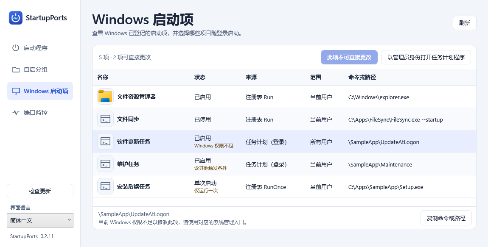
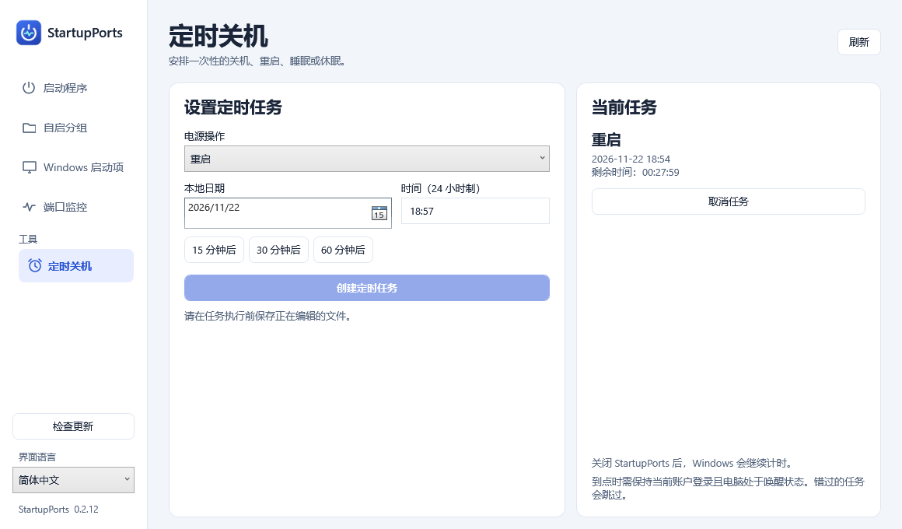
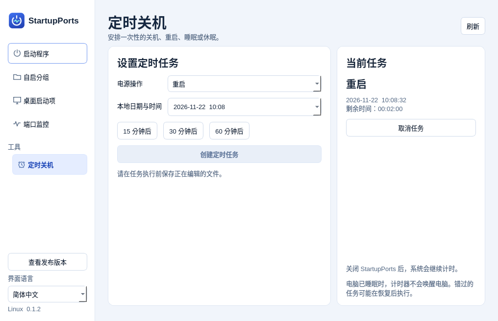
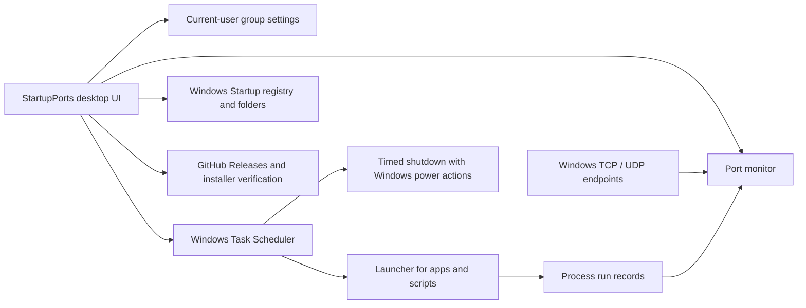

# StartupPorts

[简体中文](README.md) · **English**

Manage which apps and scripts start when you sign in to Windows. See which processes own local ports and what launched them. Keep desktop apps and local development services in one startup list.

The Linux desktop edition supports sign-in startup, groups, local port monitoring, and timed shutdown. [Download the Linux 0.1.2 source package](https://github.com/Bigesila-B/startup-ports/releases/tag/linux-v0.1.2) · [Linux guide](linux/README.en.md)

## Screenshots

Windows Startup Items with sample data, shown in Simplified Chinese. The header counts entries you can change, and restricted rows show the reason below their status.



Tools → Timed shutdown on Windows, shown in Simplified Chinese with a sample countdown.



Tools → Timed shutdown on Linux, shown in Simplified Chinese with a test timer.



## Install and use

Download the Windows 11 x64 installer, `StartupPorts-*-win-x64-setup.exe`, from [GitHub Releases](https://github.com/Bigesila-B/startup-ports/releases). It installs for the current Windows account and includes the .NET runtime. Setup is available in Simplified Chinese and English, with an optional desktop shortcut. The app first opens in the language chosen in Setup. You can switch languages at any time using the selector at the bottom left, and the app remembers your choice.

1. In Startup Apps (启动程序), select Add Startup Item (添加自启项) and choose an `.exe`, `.bat`, `.cmd`, or `.ps1` file. Set arguments, a working directory, and a sign-in delay as needed.
2. If the app listens on a port, enter the expected port and choose TCP or UDP. Save the entry and select Run Now (立即运行) to check whether the startup item owns that port. Select an item to see which ports it actually uses or which process owns the expected port.
3. In Port Monitor (端口监控), search by port, process name, or PID. Select a row to copy the address, open a supported TCP address in your browser, or prefill a startup item. If a script launched the process, you can use that script in place of the executable in the prefilled form.

Windows Startup Items (Windows 启动项) lists existing Run and RunOnce registry entries, the current user's and shared Startup folders, and readable scheduled logon tasks. Disable or restore supported items when your account has write access. This includes logon-only tasks that run in your standard interactive session, even when any user's sign-in can trigger them. Each restricted item shows a reason and offers a shortcut to Startup settings or Task Scheduler. Windows Startup settings also manages Store apps registered there.

In Startup Groups, choose **New group**, name it, and select the apps or scripts to keep together. Select a folder card to see its members and their current sign-in status, or run the whole group. Bulk sign-in changes also appear in Startup Apps and every group containing those members.

Open **Tools → Timed shutdown** to schedule a one-time shutdown, restart, sleep, or hibernation. Choose a local date and time or use the 15-, 30-, or 60-minute presets. Windows keeps the timer after you close StartupPorts. You can cancel before it starts. Stay signed in and keep the computer awake at the scheduled time. Missed timers are skipped.

Windows Task Scheduler runs enabled items the next time the current account signs in, even if the main window is closed. Disabling an item turns off its sign-in trigger. You can still test it with Run Now. PowerShell scripts follow the account's execution policy, and batch arguments follow CMD syntax.

The monitor covers IPv4 and IPv6 TCP listeners and UDP bindings. Addresses for the same process, protocol, and port are grouped in one row, with filters for process ownership. The process column shows the app icon and readable app name alongside the executable name and PID. A generic icon is shown when Windows provides no app icon. StartupPorts identifies launch sources from verifiable parent processes or from its own launch records. Before ending a process, the app asks for confirmation and checks that it still owns the port.

Choose a folder during your first installation. The default is `%LOCALAPPDATA%\Programs\StartupPorts`. Updates reuse the existing folder and keep your startup tasks. Some port ownership details become available again the next time StartupPorts launches the item. To change folders, save your startup item settings, uninstall, and reinstall in the new folder. Uninstalling removes tasks registered by StartupPorts and leaves the apps it launched running.

StartupPorts checks GitHub for new releases when it opens. Use **Check for updates** at the bottom left to check manually or turn off startup checks. When a release is available, download and verify its installer, then open the setup wizard to finish the update.

## Architecture



## Build from source

You need Windows 11 x64 and the [.NET 10 SDK](https://dotnet.microsoft.com/download/dotnet/10.0). To build the installer, also install [Inno Setup](https://jrsoftware.org/inno-setup/downloads).

```powershell
dotnet build StartupPorts.slnx
dotnet run --project src/StartupPorts
dotnet run --project tests/StartupPorts.Checks
./scripts/build-installer.ps1
```

In an interactive Windows session, you can also run the `--scheduler` checks. They register temporary tasks, try all four launch target types, verify child-process port ownership and process termination, and remove the test tasks.

```powershell
dotnet run --project tests/StartupPorts.Checks -- --scheduler './src/StartupPorts/bin/Debug/net10.0-windows/StartupPorts.exe'
```

## Credits and license

The port list, new-port notifications, and process launch-source features were inspired by [local-ops](https://github.com/laogou717/local-ops). StartupPorts implements these features using native Windows APIs. The project is released under the [MIT License](LICENSE).

The installer uses the Inno Setup Simplified Chinese translation maintained by Zhenghan Yang. [Translation source](https://jrsoftware.org/inno-setup/translations) · [Inno Setup license](installer/InnoSetup-LICENSE.txt)
