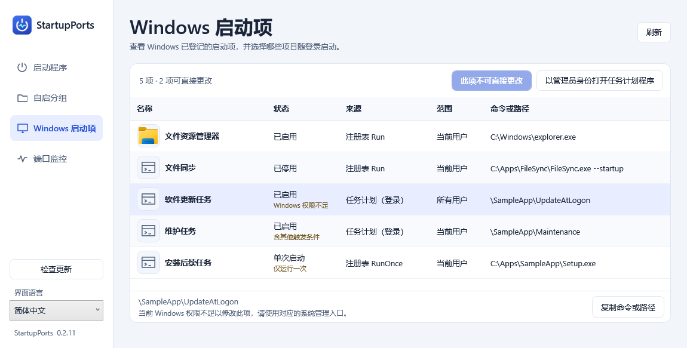
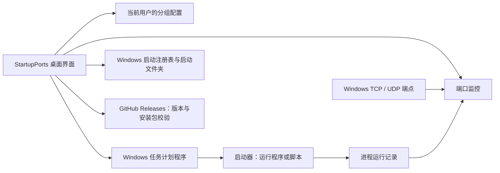

# StartupPorts

**简体中文** · [English](README.en.md)

在 Windows 上设置登录自启，同时查看本机的端口占用、监听进程和启动来源。适合把桌面程序和本地开发服务放进同一张自启列表。

Linux 桌面版可从 [StartupPorts Linux 0.1.0 发行页](https://github.com/Bigesila-B/startup-ports/releases/tag/linux-v0.1.0) 下载源码包。依赖和运行步骤见 [Linux 使用说明](linux/README.md)。

## 界面展示

「Windows 启动项」页面示例。页头统计可直接更改的项目，受限项目在状态下方显示原因。



## 安装与使用

从 [GitHub Releases](https://github.com/Bigesila-B/startup-ports/releases) 下载 Windows 11 x64 安装包 `StartupPorts-*-win-x64-setup.exe`。安装仅针对当前 Windows 账户，已包括 .NET 运行时。安装向导支持简体中文和英文，也可勾选创建桌面快捷方式。首次打开默认沿用安装时所选的语言，之后可以在软件左下角切换，语言偏好会保留。

1. 在「启动程序」点击「添加自启项」，选择 `.exe`、`.bat`、`.cmd` 或 `.ps1`。按需填写参数、工作目录和登录后延迟。
2. 如果程序会监听端口，填写预期端口和 TCP 或 UDP 协议。保存后可点击「立即运行」，在任务行查看预期端口是否由该项监听。选择任务行可查看实际端口或占用进程。
3. 在「端口监控」搜索端口、进程或 PID。选中一行可以复制地址、对支持的 TCP 地址打开浏览器，或者预填一条自启配置。若端点由脚本启动，可把预填的可执行文件改为原来的脚本。

「Windows 启动项」显示现有的注册表 Run/RunOnce 项、当前用户和公共启动文件夹，以及可读取的登录计划任务。选中支持且有权限更改的项目，即可停用或恢复登录自启。即使触发器允许任意用户登录，只在当前账户的普通登录会话中运行的任务也可支持。受限项目会逐项显示原因，并提供 Windows 启动设置或任务计划程序入口。Windows 启动设置也可管理通过系统登记的商店应用。

在「自启分组」中点击「新建分组」，填写名称并勾选要放在一起的程序和脚本。选中左侧的文件夹卡片，在右侧查看成员和登录自启状态，或立即运行整组。批量启用和停用操作会同步到「启动程序」和包含这些成员的其他分组。

自启由 Windows 任务计划程序执行。主窗口关闭后，启用的条目仍在当前账户下一次登录时运行。停用一项只关闭登录触发器，「立即运行」仍可用于试跑。PowerShell 脚本遵循当前账户的执行策略，批处理参数遵循 CMD 语法。

端口查看覆盖 IPv4、IPv6、TCP 监听与 UDP 绑定。同一进程在同一协议和端口上的多个地址合并到一行，可按进程归属筛选。进程列显示程序图标和可读的程序名称，也保留可执行文件名和 PID。Windows 未提供图标时会显示通用标识。启动来源来自可验证的父进程链或本工具记录的进程归属。结束进程时，应用会要求确认并复核当前占用者。

首次安装可选择目录。默认目录为 `%LOCALAPPDATA%\Programs\StartupPorts`。升级沿用已安装的目录并保留自启任务。部分实时归属会在下次受管启动后恢复。若要换目录，请备份自启项的配置，再卸载并按新路径重新安装。卸载会移除本工具登记的自启任务，已启动的目标程序继续运行。

软件启动时会检查 GitHub 上的新版本。你也可以用左下角「检查更新」手动查询，或在这个窗口关闭自动检查。发现更新后可下载并校验安装包，再点「打开安装向导」自行完成升级。

## 架构



## 从源码构建

需要 Windows 11 x64 和 [.NET 10 SDK](https://dotnet.microsoft.com/download/dotnet/10.0)。生成安装包另需 [Inno Setup](https://jrsoftware.org/inno-setup/downloads)。

```powershell
dotnet build StartupPorts.slnx
dotnet run --project src/StartupPorts
dotnet run --project tests/StartupPorts.Checks
./scripts/build-installer.ps1
```

已登录的交互式 Windows 会话可增加 `--scheduler` 检查。它登记临时任务，试跑四种启动目标，检查子进程端口归属和结束操作，随后清理测试任务。

```powershell
dotnet run --project tests/StartupPorts.Checks -- --scheduler './src/StartupPorts/bin/Debug/net10.0-windows/StartupPorts.exe'
```

## 来源与许可证

端口列表、新增端口提示和启动来源的设计参考了 [local-ops](https://github.com/laogou717/local-ops)。StartupPorts 使用 Windows 原生接口实现这些功能。项目采用 [MIT 许可证](LICENSE)。

安装向导使用由 Zhenghan Yang 维护的 Inno Setup 简体中文翻译。 [翻译来源](https://jrsoftware.org/inno-setup/translations) · [Inno Setup 许可证](installer/InnoSetup-LICENSE.txt)
