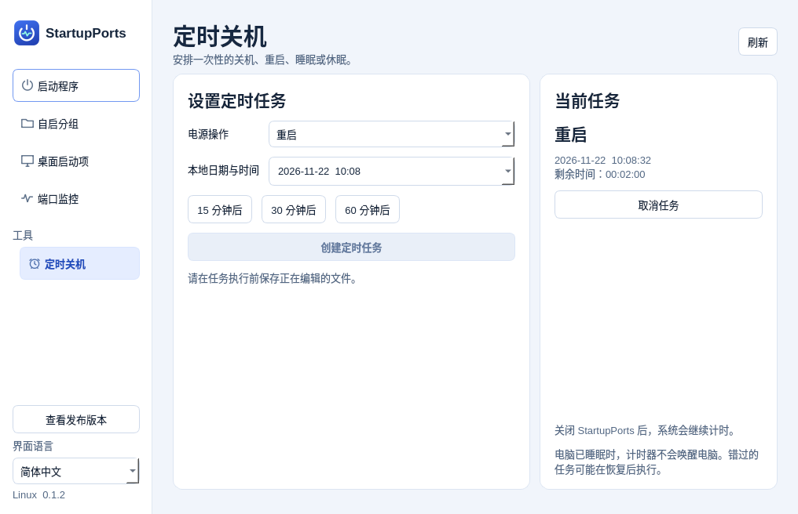
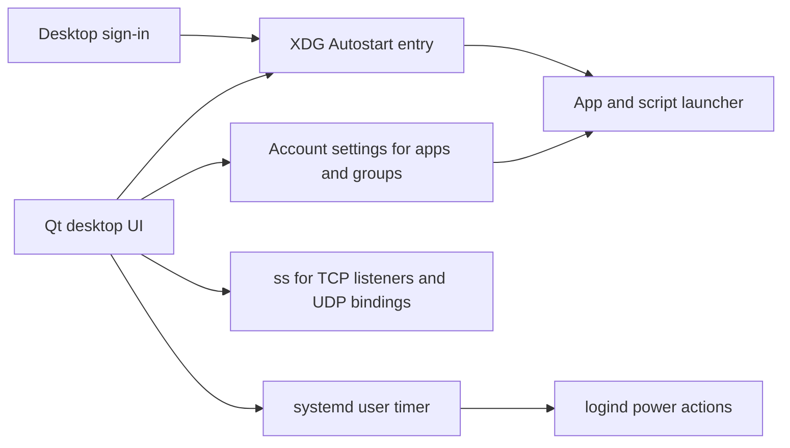

# StartupPorts for Linux

[简体中文](README.md) · **English**

Manage desktop sign-in startup, startup groups, existing desktop startup entries, and local ports on Linux. The app supports English and Simplified Chinese.



## Run the app

Use a Linux desktop with Python 3.10 or later and the `venv` module. The port monitor uses the `ss` command from iproute2. On Debian or Ubuntu, install `python3-venv` and `iproute2` if those components are missing.

From the extracted `linux` directory or the repository’s `linux` directory, run:

```sh
sh setup.sh
sh run.sh
```

Setup downloads Qt for Python into `.venv` in that directory. Keep the extracted directory at the same location after enabling sign-in startup so the launcher can find it.

## Use the app

- **Startup apps** adds executable programs and scripts. Set arguments, working directory, and delay as needed. Arguments use command-line quoting and are passed directly to the program.
- **Startup groups** organizes existing entries. View member icons, run a group, or change sign-in settings for its members in bulk. These are the same entries shown in Startup apps.
- **Desktop startup** manages XDG desktop entries. Disabling a system default creates an override for your account. Restricted entries explain the reason in their row.
- **Port monitor** shows TCP listeners and UDP bindings. Search the list, copy addresses, or open a local TCP address in a browser. Process details depend on the permissions Linux grants your account.
- **Tools → Timed shutdown** sets a one-time shutdown, restart, sleep, or hibernation. Pick a time in your local time zone and confirm it. The system continues timing after you close StartupPorts, and you can cancel before it runs.

Timed shutdown uses systemd user timers and logind. The app checks whether the selected action is available and permitted. You can set one timer at a time. Set a new timer after rebooting. The timer does not wake a sleeping computer, and a missed action may run when the computer wakes. The test command `.venv/bin/python check_power.py` writes to a temporary test file.

Startup runs at sign-in on desktops that support XDG Autostart. Linux manages system services and pre-login jobs separately. Settings are stored in `$XDG_CONFIG_HOME/startupports` (normally `~/.config/startupports`). If you remove the portable directory, you can remove its login launcher from `~/.config/autostart/io.github.BigesilaB.StartupPorts.desktop`. The separate settings directory stores your apps and groups.

## Architecture


